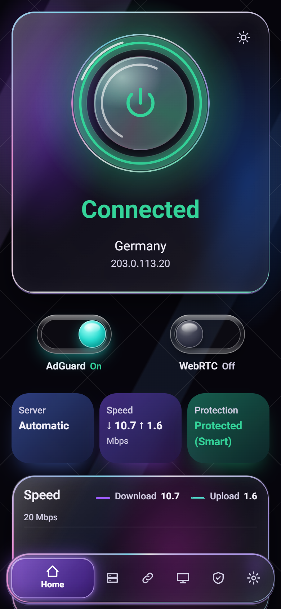
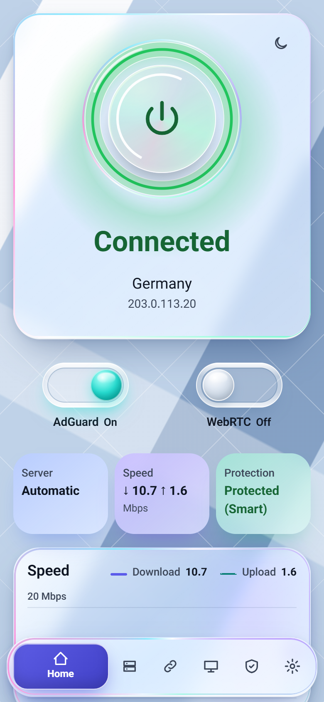

<div dir="rtl">

# داشبورد PassWall برای OpenWrt

[English](README.md)

یک داشبورد وب کوچک و دوزبانه (فارسی و انگلیسی) برای PassWall2 روی OpenWrt. این پروژه یک صفحهٔ ایستا به‌همراه اسکریپت‌های CGI از نوع شل POSIX است، پس روی روتر به Node یا Python نیازی نیست.

<div dir="ltr">

A small bilingual (Persian and English) web dashboard for PassWall2 on OpenWrt. It is a static page plus POSIX shell CGI scripts, so it needs no Node or Python on the router.

</div>

<p align="center">
  
  
</p>

## امکانات

- حلقهٔ روشن/خاموش: یک کنترل برای روشن و خاموش کردن پروکسی، با نمایش وضعیت واقعی.
- سرورها با تست واقعی: تأخیر با اتصال TCP، یا یک درخواست واقعی از مسیر سرور انتخاب‌شده.
- انتخاب خودکار بهترین سرور: یک بالانسر که بین سرورها جابه‌جا می‌شود، با فهرست سرور و فاصلهٔ بررسی قابل ذخیره.
- اشتراک‌ها: افزودن، تغییر و حذف لینک اشتراک، به‌روزرسانی با محدودیت زمانی، و چسباندن لینک‌های تکی.
- کیل سوئیچ با حالت هوشمند و سخت‌گیرانه: وقتی PassWall از کار افتاده، نمی‌گذارد دستگاه‌های LAN از خط اینترنت معمولی به سایت‌های خارجی برسند.
- محافظت در برابر نشت DNS: تا وقتی کیل سوئیچ فعال است، DNS دستگاه‌ها به روتر هدایت می‌شود و تا وقتی PassWall کار می‌کند از مسیر آن انجام می‌شود.
- کلید AdGuard Home و گزارش‌ها: مسدودسازی تبلیغ را فوری روشن یا خاموش کنید و گزارش درخواست‌ها را ببینید.
- کلید پنهان‌سازی WebRTC و IP: STUN روی UDP را در همهٔ پورت‌ها می‌بندد، IPv6 دستگاه‌ها را قطع می‌کند و کیل سوئیچ را فعال نگه می‌دارد، و به این شکل راه‌های معمول فهمیدن IP واقعی را می‌بندد. محدودیت‌ها را پایین‌تر ببینید.
- دستگاه‌ها: فهرست دستگاه‌های متصل از روی اجاره‌های DHCP.
- تنظیمات وای‌فای و رمز: تغییر نام و رمز شبکه‌ها و رمز root روتر.
- رابط فارسی و انگلیسی، راست‌به‌چپ و چپ‌به‌راست.
- تم تیره و روشن «شیشهٔ مایع» (Liquid Glass).
- برنامهٔ اندروید که از خود روتر نصب می‌شود.

## پیش‌نیازها

- OpenWrt 24.10 که PassWall2 از قبل روی آن نصب و کار می‌کند.
- پل استاندارد LAN با نام `br-lan`.
- دسترسی SSH به روتر با کاربر root.
- آزمایش‌شده روی OpenWrt 24.10.

## نصب

این دستور را از طریق SSH روی روتر اجرا کنید:

```sh
wget -O- https://raw.githubusercontent.com/RezRRX99/openwrt-passwall-dashboard/main/install.sh | sh
```

سپس از یک دستگاه داخل شبکه آدرس `http://192.168.1.1/dash/` را باز کنید (آدرس روتر خودتان را بزنید).

## به‌روزرسانی

دستور نصب را دوباره اجرا کنید. همین دستور برای به‌روزرسانی هم کار می‌کند.

## حذف

```sh
wget -O- https://raw.githubusercontent.com/RezRRX99/openwrt-passwall-dashboard/main/uninstall.sh | sh
```

## قدم‌های اول

1. داشبورد را در مرورگر یک دستگاه داخل شبکه باز کنید و با رمز root روتر وارد شوید.
2. یک اشتراک اضافه کنید یا لینک‌های سرور را بچسبانید تا سرور داشته باشید.
3. یک سرور انتخاب کنید یا انتخاب خودکار بهترین سرور را روشن کنید، سپس حلقه را روشن کنید.
4. حالت کیل سوئیچ (هوشمند یا سخت‌گیرانه) را در تنظیمات بررسی کنید.
5. اگر رمز root و رمز وای‌فای هنوز پیش‌فرض است، آن‌ها را تغییر دهید.

## برنامهٔ اندروید

در داشبورد ردیفی هست که برنامهٔ اندروید را پیشنهاد می‌دهد. داشبورد را روی گوشی باز کنید، برنامه را از همان ردیف دانلود کنید و فایل را برای نصب باز کنید. برنامه در Google Play نیست؛ از روتر نصب می‌شود و اندروید ممکن است دربارهٔ آن هشدار بدهد. اگر اندروید پرسید، نصب از مرورگر خود را مجاز کنید.

برای بررسی برنامه‌ای که از جای دیگری گرفته‌اید، گواهی امضای آن را با `apksigner verify --print-certs` مقایسه کنید. SHA-256:

```
8a26bbded4c5d4726b1166501d015d424044b92cd35f9e424287b8ee70a51377
```

## محدودیت‌ها

- PassWall2 لازم است. داشبورد آن را نصب یا جایگزین نمی‌کند.
- شبکهٔ LAN باید پل استاندارد `br-lan` باشد. چیدمان‌های دیگر پشتیبانی نمی‌شود.
- تا الان فقط روی یک روتر آزمایش شده است.
- کلید WebRTC ترافیک STUN را در روتر مسدود می‌کند و نمی‌تواند داخل مرورگر عمل کند. آدرس‌های خصوصی هنوز ممکن است در تست نشت دیده شوند. تا وقتی روشن است، بعضی تماس‌های وب ممکن است کار نکنند. همچنین تا وقتی روشن است، اگر پروکسی خاموش باشد سایت‌های خارجی بسته می‌مانند.
- حالت هوشمند کیل سوئیچ مقصدهای ایرانی را عبور می‌دهد و آن سایت‌ها IP واقعی را می‌بینند. حالت سخت‌گیرانه همهٔ سایت‌ها را می‌بندد، ولی آدرس‌های خصوصی و پینگ عبور می‌کنند.
- محافظت فقط دستگاه‌های `br-lan` را پوشش می‌دهد و شبکهٔ مهمان روی پل دیگر پوشش داده نمی‌شود.
- ترافیک خود روتر بیرون از کیل سوئیچ است. به‌روزرسانی اشتراک، تست سرورها و DNS ممکن است وقتی پروکسی خاموش است از خط واقعی بروند.
- برنامهٔ اندروید در Google Play نیست، پس از روتر نصب می‌شود و اندروید ممکن است هشدار بدهد.
- این پروژه وابسته به OpenWrt یا PassWall نیست.

## توسعه

سرور آزمایشی و تست‌ها روی کامپیوتر اجرا می‌شوند. تست e2e به بستهٔ Python به نام `playwright` و یک Chrome نصب‌شده نیاز دارد.

```sh
python tools/mock_server.py
python tools/e2e.py
```

سرور آزمایشی به‌طور پیش‌فرض روی `http://127.0.0.1:8099/` گوش می‌دهد. فایل‌های `CONTRIBUTING.md` و `docs/ARCHITECTURE.md` را ببینید.

## Support

ما یک تیم هستیم و دغدغهٔ اصلی‌مان امنیت است. در این شرایط سخت، حمایت شما می‌تواند باعث شود من و تیمم زنده بمانیم و بتوانیم کسب‌وکارمان را رشد بدهیم.

می‌خواهیم ضمن کمک به حفظ امنیت، آزادی اطلاعات و اینترنت برای کاربران ایرانی و تمام دنیا، پیش از آنکه هوش مصنوعی بیش از حد پیشرفته شود و کامپیوترهای کوانتومی از راه برسند، برای مسائل امنیتی و حفظ حریم خصوصی کاربران ایرانی راه‌حلی مطمئن پیدا کنیم.

پس کمک شما می‌تواند کمکی به آیندهٔ امنیت در دنیا باشد.

**زنده باد آزادی.**

آدرس کیف پول:

```
0xc4192247B7A35BD8601Ef4813912f5A70580eb53
```

این آدرس روی اتریوم و شبکه‌های سازگار با آن کار می‌کند، از جمله Arbitrum، Optimism، Base و Polygon. می‌توانید ETH، USDT یا USDC بفرستید.

از شبکه‌های ناسازگار مثل Tron (TRC20) یا بیت‌کوین به این آدرس نفرستید، چون پول از دست می‌رود. پیش از ارسال، آدرس و شبکه را دوباره بررسی کنید. حمایت مالی کاملاً اختیاری و غیرقابل بازگشت است.

<div dir="ltr">

We are a team whose main concern is security. In these hard times, your support can help me and my team survive and grow our business.

While helping to protect security, the freedom of information and the internet for Iranian users and people everywhere, we want to find a dependable answer to the security and privacy problems of Iranian users, before AI advances too far and quantum computers arrive.

So your help can be a contribution to the future of security in the world.

**Long live freedom.**

Wallet address:

```
0xc4192247B7A35BD8601Ef4813912f5A70580eb53
```

This address works on Ethereum and compatible networks, including Arbitrum, Optimism, Base and Polygon. You can send ETH, USDT or USDC.

Do not send to it from incompatible networks such as Tron (TRC20) or Bitcoin, because the funds would be lost. Check the address and the network before sending. Donations are entirely voluntary and cannot be refunded.

</div>

## مجوز

GPL-3.0، فایل `LICENSE` را ببینید. فونت Vazirmatn تحت مجوز SIL OFL است، فایل `www/dash/OFL.txt` را ببینید.

</div>
