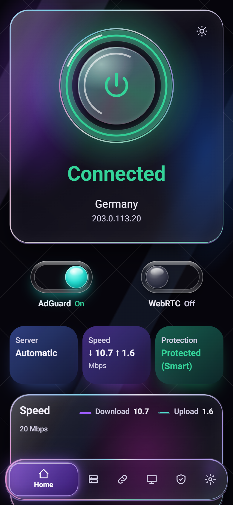
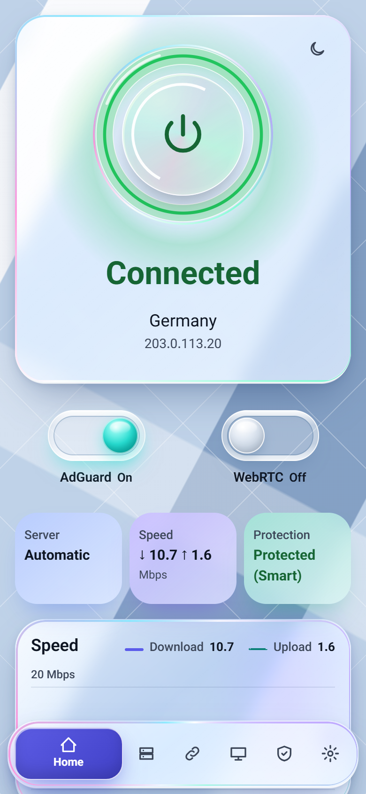

# OpenWrt PassWall Dashboard

**English** | [فارسی](README.fa.md)

A small bilingual (Persian and English) web dashboard for PassWall2 on OpenWrt. It is a static page plus POSIX shell CGI scripts, so it needs no Node or Python on the router.

<p align="center">
  
  
</p>

## Features

- Ring on/off: one control to turn the proxy on or off, with its real state shown.
- Servers with real tests: latency by TCP connect, or a real request through the chosen server.
- Automatic best server: a balancer that switches between servers, with a saved server list and check interval.
- Subscriptions: add, change and delete subscription links, update them with a time limit, and paste single share links.
- Kill switch with smart and strict modes: when PassWall is down, stops LAN devices reaching foreign sites on the normal internet line.
- DNS leak protection: while the kill switch is armed, client DNS is redirected to the router, which resolves through PassWall while it runs.
- AdGuard Home switch and reports: turn ad blocking on or off instantly and see query reports.
- WebRTC and IP hiding switch: drops UDP STUN on every port, blocks client IPv6 and keeps the kill switch armed, which stops the usual ways a site learns the real IP. See the limits below.
- Devices: the list of clients from the DHCP leases.
- Wi-Fi and password settings: change network names and passwords, and the router root password.
- Persian and English interface, right-to-left and left-to-right.
- Dark and light "Liquid Glass" theme.
- Android app, installed from the router.

## Requirements

- OpenWrt 24.10 with PassWall2 already installed and working.
- The standard `br-lan` LAN bridge.
- SSH access to the router as root.
- Tested on OpenWrt 24.10.

## Install

Run this over SSH on the router:

```sh
curl -fsSL -m 60 -x socks5h://127.0.0.1:$(uci -q get 'passwall2.@global[0].node_socks_port' || echo 1070) https://raw.githubusercontent.com/RezRRX99/openwrt-passwall-dashboard/main/install.sh | sh
```

This goes through PassWall, because many internet lines, including those in Iran, cannot reach GitHub directly. PassWall must be connected. If your router reaches GitHub without it, remove `-x socks5h://...` and the port from the command.

Then open `http://192.168.1.1/dash/` (use your router address) from a device on the LAN.

## Update

Run the install command again. It also works as the update command.

## Uninstall

```sh
curl -fsSL -m 60 -x socks5h://127.0.0.1:$(uci -q get 'passwall2.@global[0].node_socks_port' || echo 1070) https://raw.githubusercontent.com/RezRRX99/openwrt-passwall-dashboard/main/uninstall.sh | sh
```

## First steps

1. Open the dashboard in a browser on the LAN and log in with the router root password.
2. Add a subscription, or paste share links, so there are servers to use.
3. Pick a server or turn on automatic best server, then turn the ring on.
4. Check the kill switch mode (smart or strict) in the settings.
5. Change the root and Wi-Fi passwords if they are still the defaults.

## Android app

The dashboard has a row that offers an Android app for the phone. Open the dashboard on the phone, download the app from that row and open the file to install it. The app is not on Google Play, so it installs from the router and Android may show a warning about it. If Android asks, allow installs from your browser.

To check an app you got elsewhere, compare its signing certificate with `apksigner verify --print-certs`. SHA-256:

```
8a26bbded4c5d4726b1166501d015d424044b92cd35f9e424287b8ee70a51377
```

## Honest limits

- PassWall2 is required. The dashboard does not install or replace it.
- The LAN must be the standard `br-lan` bridge. Other layouts are not handled.
- It has been tested on one router so far.
- The WebRTC switch blocks STUN on the router. It cannot act inside a browser. Private addresses can still show in leak tests. Some web calls may fail while it is on. While it is on, foreign sites stay closed if the proxy is off.
- Smart kill switch mode lets Iranian destinations through, and those sites see the real IP. Strict mode blocks all sites, but private addresses and ping still pass.
- Protection covers devices on `br-lan` only. A guest network on another bridge is not covered.
- The router's own traffic is outside the kill switch. Subscription updates, server tests and DNS lookups can leave on the real line while the proxy is off.
- The Android app is not on Google Play, so it installs from the router and Android may warn about it.
- This project is not affiliated with OpenWrt or PassWall.

## Development

The mock server and tests run on a PC. The e2e test needs the Python `playwright` package and an installed Chrome.

```sh
python tools/mock_server.py
python tools/e2e.py
```

The mock listens on `http://127.0.0.1:8099/` by default. See `CONTRIBUTING.md` and `docs/ARCHITECTURE.md`.

## Support

We are a team whose main concern is security. In these hard times, your support can help me and my team survive and grow our business.

While helping to protect security, the freedom of information and the internet for Iranian users and people everywhere, we want to find a dependable answer to the security and privacy problems of Iranian users, before AI advances too far and quantum computers arrive.

So your help can be a contribution to the future of security in the world.

**Long live freedom.**

Wallet address:

```
0xc4192247B7A35BD8601Ef4813912f5A70580eb53
```

This address works on Ethereum and compatible networks, including Arbitrum, Optimism, Base and Polygon. You can send ETH, USDT or USDC.

Do not send to it from incompatible networks such as Tron (TRC20) or Bitcoin, because the funds would be lost. Check the address and the network before sending.

Supporting me and my team is entirely optional. Any commercial or non-commercial use of this repository is free, and I hope you find it useful.

## License

GPL-3.0, see `LICENSE`. The Vazirmatn font is under the SIL Open Font License, see `www/dash/OFL.txt`.
